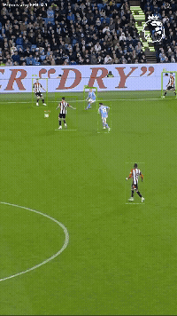
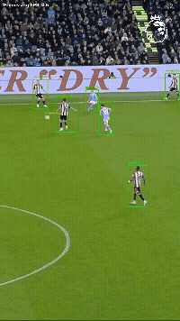
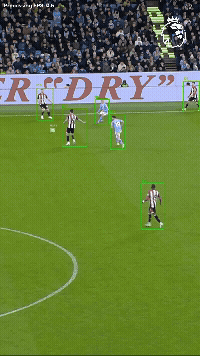

# Real-time football video analytics

| Input  | Team classication | Players Detection | Tracking |
| ------------- | ------------- | ------------- | ------------- |
|   |   |   |   |

Command for testing

`python .\src\main.py --source .\video\input\test.mp4 --output .\video\output\test.mp4 --model "yolo26n.pt"`

Debug data:
Frames processed: 404
Average FPS: 38.77
