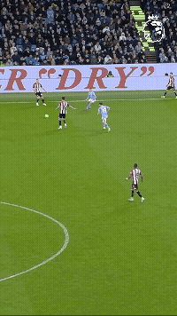

# Real-time football video analytics

| Input | Team Classification | Player Detection | Player Tracking |
| --- | --- | --- | --- |
|  |  |  |  |
| Original football broadcast footage used as input for real-time video analysis. | Classifies players into their respective teams using jersey colour features and a K-Nearest Neighbours (KNN) classifier. | Detects players, referees and goalkeepers using a fine-tuned YOLO26n object detection model. | Tracks detected players across consecutive frames by assigning persistent identifiers to maintain temporal consistency. |
| Video Link | [team.mp4](/video/output/team.mp4) | [detection.mp4](/video/output/detection.mp4) | [track.mp4](/video/output/track.mp4) |

Command for testing

`python .\src\main.py --source .\video\input\test.mp4 --output .\video\output\test.mp4 --model "yolo26n.pt"`

Debug data:
Frames processed: 404
Average FPS: 38.77
